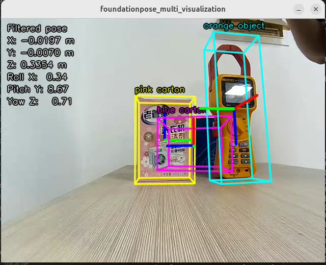
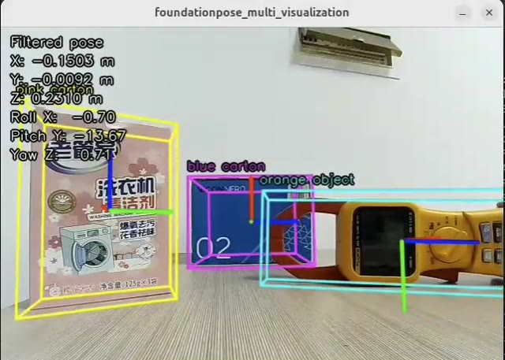
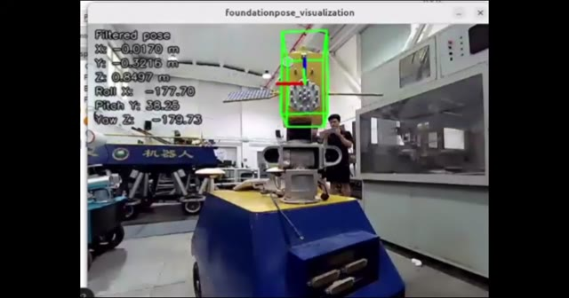
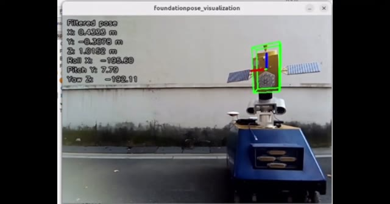

# 双目深度与多目标 6D 位姿跟踪部署

本仓库把 Fast-FoundationStereo（FFS）、GroundingDINO + Segment Anything（SAM）、FoundationPose 的 C++/TensorRT 推理接成 ROS 2 双目跟踪流程，并提供仿真双目渲染及应用程序。输入左右相机图像、相机标定、目标网格和首帧掩码，连续输出每个物体相对于左相机的 6D 位姿。

## 实验视频

点击预览图可在 GitHub 打开或下载仓库中的原始 MP4。它们展示跟踪叠加效果，并非精度基准或性能测量。

| 场景 | 视频 |
| --- | --- |
| 三目标快速运动 | [](media/three_fast.mp4) |
| 三目标慢速运动 | [](media/three_slow.mp4) |
| 室内实验 | [](media/indoor.mp4) |
| 室外实验 | [](media/outdoor.mp4) |

## 自采数据集

项目使用的自采数据集已存放在公共网盘，涵盖五个物体，分为重建与慢速运动数据、快速运动数据两份。数据集通过网盘单独提供，不包含在本 Git 仓库中。

| 压缩包 | 内容 | 下载链接 |
| --- | --- | --- |
| `reconstruct.zip` | 五个物体的重建与慢速运动数据 | [百度网盘下载（提取码：tiaq）](https://pan.baidu.com/s/1HcqH1y95vTCZS0oTlzi8PA?pwd=tiaq) |
| `fast-move.zip` | 五个物体的快速运动数据 | [百度网盘下载（提取码：yhfr）](https://pan.baidu.com/s/1aLCFS98yQqDvIIp9RXmsWA?pwd=yhfr) |

## 功能与代码流程

1. `fp/.../foundationpose_stereo_tracker_*_node.cpp` 同步左右 ROS 图像，检查时间戳，对双目图像做极线校正并按 FFS 输入尺寸缩放补边。
2. `ffs/src/ffs_pkg` 的 TensorRT FFS 模型输出视差；节点按标定参数还原米制深度，将其映射回原始左图坐标。多目标节点还可启用深度置信度过滤。
3. `sam/src/grounded_sam_multi_first_mask_node.cpp` 用固定文本提示的 GroundingDINO 找目标框，再用 SAM 生成每个目标的二值 PNG 首帧掩码。跟踪节点轮询这些 PNG。也可以手工提供同尺寸掩码。
4. 每个目标用网格、RGB、深度和掩码执行一次 FoundationPose `Register`。随后每帧用上帧滤波预测位姿作为 `Track` 的初值，再通过 refiner 得到观测位姿。多目标节点为每个对象创建独立跟踪 worker，同一帧统一收集结果。
5. 共用的自适应 SE(3) 滤波器根据右不变运动模型预测位姿，以观测残差估算质量，调整观测协方差，并用马氏距离门控异常值。最终位姿同时用于下一帧跟踪初值、`PoseStamped` 发布、日志和可视化；跟踪调用失败时输出预测位姿。
6. `sim/` 提供 C++/Python 双目渲染和 `satellite_stereo` 字节流到 ROS 图像的接口，`app/` 提供多目标演示和星地双目应用界面。

单目标入口是 `foundationpose_stereo_tracker_fast_node`，多目标入口是 `foundationpose_stereo_tracker_multi_node`。多目标 ROS 位姿话题为 `pose_topic/<目标名规范化后缀>`，第一个目标另发到 `pose_topic`。坐标系默认继承左图 `header.frame_id`，也可用 `pose_frame_id` 覆盖。输出平移单位为米，旋转以四元数表示。

## 所依赖论文与项目改动

- [Fast-FoundationStereo](https://arxiv.org/abs/2512.11130) 用知识蒸馏压缩骨干网络、分块神经架构搜索优化代价滤波、结构化剪枝减少迭代细化开销，并用自动伪标注扩充野外双目训练数据，以兼顾零样本泛化和实时速度。本仓库将它以 TensorRT 双阶段引擎接入双目深度链路。
- [FoundationPose](https://github.com/NVlabs/FoundationPose) 利用已知物体网格和首帧掩码做 6D 位姿注册，以渲染与网络细化进行后续跟踪。本仓库的 C++ 版本把位姿转回原始 mesh 坐标系，集成多目标工作线程和预测反馈。
- [GroundingDINO](https://github.com/IDEA-Research/GroundingDINO) 与 [Segment Anything](https://github.com/facebookresearch/segment-anything) 分别提供开放词汇目标框和掩码。本仓库使用固定提示词导出的 TensorRT 引擎，换提示词时需重新导出对应 DINO 模型。当前 `sam/scripts/export_onnx.py` 导入的是原版 `segment_anything`，**不是 SAM 2**。
- 自适应滤波来自本地 FoundationPose Python 脚本 `run_demo_adaptive_filter.py` 及其 `tracking/adaptive_se3_pose_filter.py`，属于本工程新增的部署逻辑，并非上述论文的原创贡献。C++ 实现在 `fp/src/foundationpose_cpp/src/adaptive_se3_pose_filter.hpp`。

## 环境要求

当前工程按 Linux、ROS 2 Jazzy、C++17、NVIDIA GPU、CUDA、TensorRT 10、OpenCV 4、Eigen3 构建；`fp` 的 CMake 目前将 TensorRT 头文件和库路径指向 `/usr/src/tensorrt` 的 x86_64 布局，迁移到其他平台须调整该路径。还需要 `colcon`、`ament_cmake`、`rclcpp`、`sensor_msgs`、`geometry_msgs`、`std_msgs`、`cv_bridge`、`message_filters`、`tf2`，以及工程 CMake 所需的 Assimp、CUDA 开发包等依赖。模型导出阶段另需相应 Python 上游工程及 PyTorch；在线 C++ 推理只加载已生成的 TensorRT engine。

以下是 **2026-11-05 在本项目开发主机上实测** 的版本，仅作复现参考：

| 项目 | 本机版本 |
| --- | --- |
| 系统 / 内核 / 架构 | Ubuntu 24.04.4 LTS / Linux 7.0.0-28-generic / x86_64 |
| GPU | NVIDIA GeForce RTX 5060 Ti，显存 16311 MiB，计算能力 12.0 |
| NVIDIA 驱动 / CUDA Toolkit | 580.178.04 / 12.8.93 |
| TensorRT | 10.8.0.43（本机 `NvInferVersion.h`；`trtexec` 显示 v100800） |
| ROS 2 | Jazzy；`rclcpp` 28.1.18，`ament_cmake` 2.5.6，`cv_bridge` 4.1.0 |
| 编译工具 | GCC 13.3.0，CMake 3.28.3，colcon-core 0.20.1，Python 3.12.3 |
| 图像和几何库 | OpenCV 4.11.0（当前 `pkg-config`/Python），系统 `libopencv-dev` 4.6.0；Eigen3 3.4.0，Assimp 5.3.1 |

本机同时装有两套 OpenCV，构建时链接器报告 ROS `cv_bridge` 的 4.6 库与工程发现的 4.11 库可能冲突。该工程在本机编译通过，但复现时应尽量统一 OpenCV 运行时，特别是在不同设备或容器中。示例 YAML 含开发机绝对路径，需要改为本机路径。

项目作者另报告已在 NVIDIA Jetson Thor 开发套件、JetPack 7.2 上跑通。上述版本表来自 x86_64 开发主机，不代表 Thor 的实测库版本。Thor 上必须重新生成 engine，并把 `ffs/src/ffs_pkg/CMakeLists.txt`、`fp/src/foundationpose_cpp/CMakeLists.txt` 中写死的 `x86_64-linux-gnu` TensorRT 库路径改为设备上的 `aarch64-linux-gnu` 或实际安装路径；`sam/CMakeLists.txt` 可通过 `TENSORRT_ROOT` 搜索两种架构。还需修改配置 YAML 与 launch 文件中的模型、标定、掩码和动态库路径。

## 依赖和模型准备

```bash
source /opt/ros/jazzy/setup.bash
sudo apt install python3-colcon-common-extensions libopencv-dev libeigen3-dev libassimp-dev
```

安装匹配设备的 NVIDIA 驱动、CUDA Toolkit、TensorRT 开发与运行库，并确认 `nvcc` 和 TensorRT 头文件/库可由 CMake 找到。FFS 需要 feature/post 两个 engine，FoundationPose 需要 refiner/scorer 两个 engine；自动首帧掩码还需固定提示词 DINO engine 和 SAM encoder/decoder engine。网格文件需包含可加载的几何体及对应纹理；左右相机标定须与输入图像尺寸及实际相机一致。

**本仓库不提供 ONNX、原始权重或 TensorRT engine。** 请先从各官方项目或其授权的发布渠道下载相应模型文件，阅读各自模型许可；不要把一个设备上生成的 engine 直接复制到另一台 GPU 使用。下面命令保留了项目使用的网络输入尺寸和 batch profile，输出文件名可按自己的 YAML 修改。`TRTEXEC` 可设为当前设备上 `trtexec` 的路径。

```bash
TRTEXEC=/usr/src/tensorrt/bin/trtexec
FFS_ONNX=/path/to/official/ffs/onnx
FP_ONNX=/path/to/authorized/foundationpose/onnx
ENGINE_DIR=/path/to/local/engines
mkdir -p "$ENGINE_DIR"

"$TRTEXEC" --onnx="$FFS_ONNX/feature_runner.onnx" \
  --saveEngine="$ENGINE_DIR/feature_runner_fp16.engine" --fp16 --useCudaGraph
"$TRTEXEC" --onnx="$FFS_ONNX/post_runner.onnx" \
  --saveEngine="$ENGINE_DIR/post_runner_fp16.engine" --fp16 --useCudaGraph

"$TRTEXEC" --onnx="$FP_ONNX/scorer_hwc.onnx" \
  --minShapes=render_input:1x160x160x6,transf_input:1x160x160x6 \
  --optShapes=render_input:252x160x160x6,transf_input:252x160x160x6 \
  --maxShapes=render_input:252x160x160x6,transf_input:252x160x160x6 \
  --saveEngine="$ENGINE_DIR/scorer_hwc_dynamic_fp32.engine"
"$TRTEXEC" --onnx="$FP_ONNX/refiner_hwc.onnx" \
  --minShapes=render_input:1x160x160x6,transf_input:1x160x160x6 \
  --optShapes=render_input:252x160x160x6,transf_input:252x160x160x6 \
  --maxShapes=render_input:252x160x160x6,transf_input:252x160x160x6 \
  --saveEngine="$ENGINE_DIR/refiner_hwc_dynamic_fp32.engine"
```

上面的 FP 命令按提供的示例生成 FP32 engine；如果打算用 FP16，请在目标设备上重新验证精度与性能，并在 YAML 中填写实际文件名。GroundingDINO 和 SAM 当前流程先从各自的 PTH 权重导出 ONNX，再运行 `sam/scripts/build_engines.sh` 转 engine；`sam/scripts/export_all.sh` 和 `sam/scripts/export_dino.sh` 提供导出入口。固定提示词 DINO 的 ONNX 必须与推理时目标词一致；当前脚本使用原版 SAM 的 `segment_anything` API，不能直接用 SAM 2 的权重替换。导出所需 Python 依赖由相应上游工程提供。

## 编译和实际部署

以下命令在仓库根目录执行。各子工程独立使用自己的 `build/` 和 `install/`。

```bash
source /opt/ros/jazzy/setup.bash
cd ffs && colcon build && cd ..
cd fp && colcon build --packages-select foundationpose_cpp --cmake-args -DENABLE_TENSORRT=ON -DBUILD_SIMPLE_TESTS=OFF && cd ..
cd sam && ./scripts/build_cpp.sh && ./scripts/build_ros2.sh && cd ..
```

按对象数量复制 `fp/src/foundationpose_cpp/config/` 中的 fast 或 multi 示例 YAML，修改左右图话题、`caminfo_path`、FFS/FP engine 路径、网格、掩码目录及名称、相机内参、输出话题。自动掩码还须修改 YAML 中 `grounded_sam_multi_first_mask_node` 的对象名称、DINO/SAM engine 和输出目录，并使其输出 PNG 名称与跟踪器配置完全一致。确保模型输入与实际图像尺寸、FFS engine profile、标定一致。单目标若使用手工 PNG，可不启动自动掩码节点。

```bash
source /opt/ros/jazzy/setup.bash
source "$PWD/fp/install/setup.bash"
source "$PWD/sam/ros2_install/setup.bash"
ros2 launch foundationpose_cpp foundationpose_stereo_tracker_multi.launch.py \
  params_file:="$PWD/fp/src/foundationpose_cpp/config/你的配置.yaml"
```

另一个终端启动双目相机驱动，发布与 YAML 相同的左右图话题；离线验证可用 `ros2 bag play <bag目录>`。单目标改用 `foundationpose_stereo_tracker_fast.launch.py`。启动后可用 `ros2 topic list` 和 `ros2 topic echo /foundationpose/pose` 检查位姿。默认 launch 的部分路径仍与本仓库开发机相关，部署时检查 launch/YAML，尤其是 mask 输出目录与动态库路径。没有真实相机时，可先编译 `sim/src/sim_stereo_cpp` 并启动 `stereo_render_cpp.launch.py`，或者在相应 Python 环境运行 `app/sim_stereo_multi_app.py`；星地字节流与 ROS 图像转换入口在 `sim/src/satellite_stereo`，应用程序入口是 `app/satellite_stereo_multi_app.py`。

### 星地多目标 App

完成 `satellite_stereo`、`foundationpose_cpp` 和 SAM 的编译后，分别在三个终端运行。先启动卫星渲染节点和 App，在 App 的“Parameters & control”页加载目标配置，给每个物体设置独立的初始位姿、平移/旋转振幅和频率，再点击“Start satellite renderer”。App 会启动地面 `stereo_bytes_to_images_node`，还原双目图像；此时“Tracking monitor”页已能显示原始左图，不依赖 FoundationPose。随后启动跟踪器，合成图、首帧掩码和位姿才会出现。

```bash
# 终端 1：卫星渲染端
source /opt/ros/jazzy/setup.bash
source /home/hc/weizi/ffs+fp+sam/sim/install/setup.bash
ros2 run satellite_stereo satellite_render_node

# 终端 2：地面 App；启动后在界面中下发配置并开始渲染
source /opt/ros/jazzy/setup.bash
source /home/hc/weizi/ffs+fp+sam/fp/install/setup.bash
source /home/hc/weizi/ffs+fp+sam/sim/install/setup.bash
python3 /home/hc/weizi/ffs+fp+sam/app/satellite_stereo_multi_app.py

# 终端 3：需要跟踪结果时再启动
source /opt/ros/jazzy/setup.bash
source /home/hc/weizi/ffs+fp+sam/fp/install/setup.bash
source /home/hc/weizi/ffs+fp+sam/sam/ros2_install/setup.bash
ros2 launch foundationpose_cpp foundationpose_stereo_tracker_multi.launch.py
```

卫星端以配置中的物体顺序向 `/satellite/ground_truth` 发布 `geometry_msgs/PoseArray`，时间戳与 `/satellite/stereo_bytes` 中的双目帧相同。真值为原始 mesh 原点在左相机光学坐标系中的位姿；跟踪器的 `pose_frame_id` 若在 YAML 中自定义，比较误差前须确认它仍表示同一左相机坐标系。App 持续显示最新真值，按图像时间戳匹配跟踪位姿和对应帧的真值来计算误差：`ΔXYZ = 跟踪平移 − 真值平移`、`|Δt|` 为三维平移误差范数、`ΔR` 为四元数相对旋转角。未匹配到真值的跟踪帧，误差显示为 `—`。旋转同时显示四元数 `(x,y,z,w)` 和固定轴 **XYZ** 欧拉角，即 `R = Rz(yaw) · Ry(pitch) · Rx(roll)`。

## 自适应滤波参数与行为

两个跟踪节点使用同一套 YAML 参数，默认值对齐 `run_demo_adaptive_filter.py` 的当前参数。`filter_fps` 为时间戳不可用时的回退帧率；正常运行时按相邻左图时间戳求 `dt`。`filter_q_pos/q_rot/q_vel/q_omega` 为 12 维状态预测噪声；`filter_sigma_pos_obs/sigma_rot_obs` 为观测标准差；`filter_sigma_pos_motion/sigma_rot_motion` 控制残差到质量分数的衰减；`filter_min_quality` 限制质量下界；`filter_gate_threshold` 是马氏距离平方门限；`filter_reject_cov_increase` 是拒绝观测时增加的协方差。`filter_enable_gating` 与 `filter_enable_adaptive_R` 可分别关闭门控和质量驱动的观测噪声调整。

首帧直接以 `Register` 位姿初始化滤波器、零速度和 `1e-3 I` 协方差。每帧先预测 `T_pred = T · Exp(xi·dt)`；`Track` 使用 `T_pred` 作初值。右不变残差 `Log(T_pred⁻¹ · T_obs)` 同时用于质量评估、卡尔曼更新与门控。观测被拒绝时保留预测位姿并增加协方差；跟踪失败时也使用预测位姿。日志中的 `quality`、`mahalanobis`、`accepted` 可用于调参。相机或物体运动速度与 Python 演示不同，门限与噪声仍应结合实际数据标定。

## 作者与论文引用

本项目的集成和部署代码由 **hc**（GitHub：`hc1600203208-ctrl`）维护；其他组件的原作者见根目录 `AUTHORS`、`NOTICE` 和各源文件版权声明。引用本部署项目时可使用 `CITATION.cff`，并按实际使用的模型引用其原论文：

```bibtex
@article{wen2026fastfoundationstereo,
  title={{Fast-FoundationStereo}: Real-Time Zero-Shot Stereo Matching},
  author={Bowen Wen and Shaurya Dewan and Stan Birchfield},
  journal={CVPR},
  year={2026}
}
@inproceedings{foundationposewen2024,
  title={{FoundationPose}: Unified 6D Pose Estimation and Tracking of Novel Objects},
  author={Bowen Wen and Wei Yang and Jan Kautz and Stan Birchfield},
  booktitle={CVPR},
  year={2024}
}
@article{liu2023grounding,
  title={Grounding DINO: Marrying DINO with Grounded Pre-Training for Open-Set Object Detection},
  author={Shilong Liu and Zhaoyang Zeng and Tianhe Ren and Feng Li and Hao Zhang and others},
  journal={arXiv preprint arXiv:2303.05499},
  year={2023}
}
@article{kirillov2023segany,
  title={Segment Anything},
  author={Alexander Kirillov and Eric Mintun and Nikhila Ravi and Hanzi Mao and Chloe Rolland and others},
  journal={arXiv preprint arXiv:2304.02643},
  year={2023}
}
```

若使用 BundleSDF 重建目标网格，还应引用 [BundleSDF（CVPR 2023）](https://arxiv.org/abs/2303.14158)。上述论文描述模型方法；自适应 SE(3) 滤波和本仓库多目标部署属于本项目集成工作。
